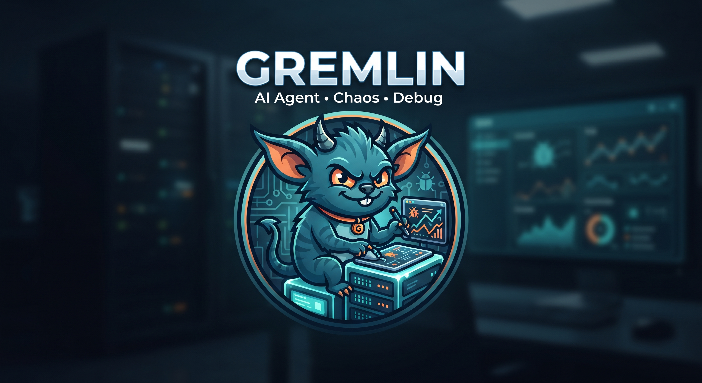
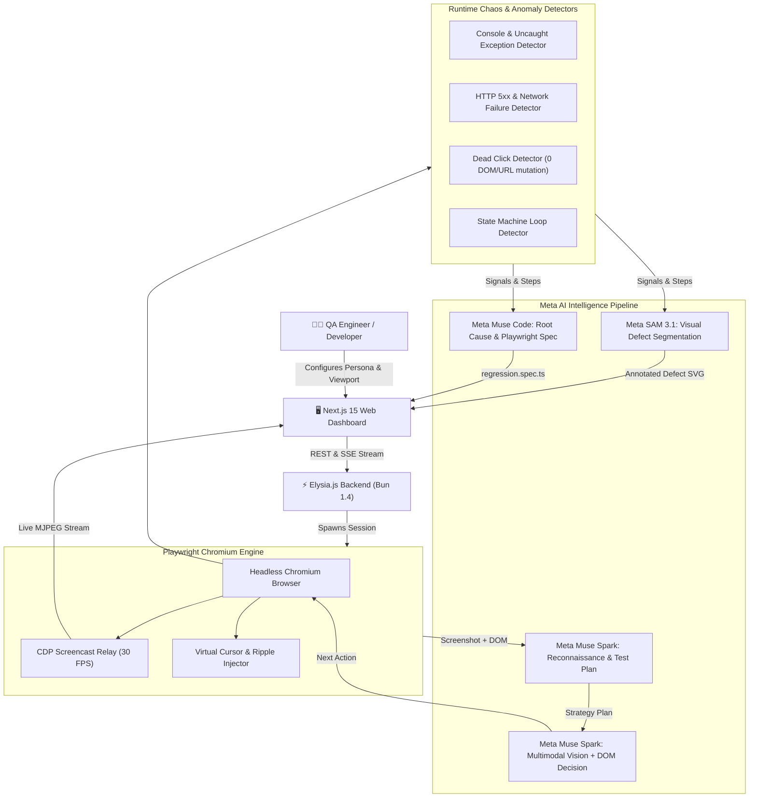

# 👾 Gremlin

<p align="center">
  
</p>

**Gremlin** is an autonomous AI-powered exploratory and chaos testing agent designed for modern web applications. Powered by **Bun 1.4**, **Elysia.js**, **Playwright**, and **Next.js**, Gremlin combines multimodal visual reasoning, automated DOM exploration, and real-time chaos injection. It watches live Chromium execution, reasons about user actions using persona-driven prompts, executes interactions with virtual cursor animations, and synthesizes bugs with visual annotations and self-healing regression test suites.

---

## 🧠 Meta AI Model Suite Architecture

Gremlin is built specifically to harness Meta's cutting-edge AI models for modern autonomous software engineering:

| Meta Model | System Role | Capabilities & Responsibilities |
|---|---|---|
| **Meta Muse Spark** | **Vision & Action Strategist** | Performs initial application reconnaissance, formulates multi-phase test plans, and evaluates visual screenshots + interactive DOM trees to decide exploratory actions. Detects mobile layout shifts and UI element clipping. |
| **Meta Muse Code** | **Synthesis & Spec Engineering** | Analyzes aggregated runtime signals (console exceptions, HTTP 500s, dead clicks), determines root cause, and generates executable self-contained Playwright regression tests (`regression.spec.ts`). |
| **Meta SAM 3.1** *(Segment Anything)* | **Visual Defect Segmentation** | Pinpoints exact coordinates of visual defects, unresponsive dead-click areas, and obscured UI controls directly onto screenshots, outputting vector SVG bounding boxes. |
| **Heuristic Fallback Engine** | **Deterministic Resilience** | Guarantees zero downtime. If external LLM endpoints hit rate limits or connection timeouts during live chaos testing, Gremlin gracefully falls back to deterministic heuristic exploration. |



---

## 🏗️ Architecture & Monorepo Structure

```
gremlin/
├── package.json                 # Monorepo workspaces & orchestrator scripts
├── bun.lock                     # Lockfile (committed)
├── .env.example                 # Environment variables reference
├── docker-compose.yml           # Containerized multi-service deployment
├── README.md                    # System documentation
├── apps/
│   ├── api/                     # Elysia.js + Bun 1.4 + SQLite Backend
│   │   ├── package.json
│   │   ├── src/
│   │   │   ├── index.ts         # Elysia application entrypoint & plugin wiring
│   │   │   ├── routes/
│   │   │   │   ├── runs.ts      # POST /runs, GET /runs, GET /runs/:id, artifacts & MJPEG stream
│   │   │   │   ├── events.ts    # GET /runs/:id/events (Server-Sent Events)
│   │   │   │   └── report.ts    # GET /runs/:id/report (synthesized findings)
│   │   │   ├── db/
│   │   │   │   ├── client.ts    # bun:sqlite client with WAL mode
│   │   │   │   ├── schema.sql   # Relational schema (runs, steps, signals, findings)
│   │   │   │   ├── migrate.ts   # Auto-migration runner
│   │   │   │   └── repo/        # runs.ts, steps.ts, signals.ts, findings.ts
│   │   │   ├── agent/
│   │   │   │   ├── loop.ts      # Core autonomous loop (Observe -> Decide -> Act -> Detect)
│   │   │   │   ├── recon.ts     # Meta Muse Spark autonomous reconnaissance & strategy
│   │   │   │   ├── cursor.ts    # Virtual cursor injection & click ripple animation
│   │   │   │   ├── observe.ts   # High-res screenshot, ARIA tree & interactive DOM parsing
│   │   │   │   ├── decide.ts    # Multimodal vision & action prompt formatting
│   │   │   │   ├── act.ts       # Playwright execution (click, dblclick, type, scroll, wait)
│   │   │   │   ├── guardrails.ts# Step limits, run timeouts, and loop detection
│   │   │   │   ├── personas.ts  # Testing personas (Chaos Gremlin, Shopper, Skeptic, Speed Demon)
│   │   │   │   └── detectors/
│   │   │   │       ├── console.ts   # Uncaught errors, warnings & page errors
│   │   │   │       ├── network.ts   # HTTP 4xx/5xx responses & failed fetches
│   │   │   │       ├── deadClick.ts # Clicks with 0 DOM change, 0 URL change & 0 network calls
│   │   │   │       └── stuck.ts     # Repetitive state traps
│   │   │   ├── report/
│   │   │   │   ├── builder.ts   # Telemetry synthesis into categorized findings
│   │   │   │   ├── annotator.ts # Meta SAM 3.1 visual bounding box defect annotator
│   │   │   │   ├── dedupe.ts    # Signal deduplication
│   │   │   │   └── exportSpec.ts# Playwright regression test generator
│   │   │   ├── llm/
│   │   │   │   ├── client.ts    # Multimodal OpenAI/Meta client + heuristic fallback
│   │   │   │   └── prompts/     # decide.md, report.md
│   │   │   └── lib/
│   │   │       ├── events.ts    # Pub/Sub event bus & SQLite persistence
│   │   │       ├── queue.ts     # In-memory concurrent run queue
│   │   │       ├── stream.ts    # Chrome DevTools Protocol MJPEG video stream manager
│   │   │       └── storage.ts   # Run artifacts management
│   │   └── tests/
│   │       └── compat.test.ts   # API, DB, and compatibility test suite
│   └── web/                     # Next.js 15 Web Application
│       ├── package.json
│       └── src/
│           ├── app/
│           │   ├── page.tsx             # Run configuration & dispatch form
│           │   ├── runs/page.tsx        # Historical exploratory sessions
│           │   └── runs/[id]/page.tsx   # Real-time Chromium stream, timeline & findings
│           ├── components/
│           │   ├── LiveBrowserView.tsx  # Interactive live browser with thought bubble
│           │   ├── RunForm.tsx          # Persona & mobile/desktop viewport toggle
│           │   ├── StepTimeline.tsx     # Visual step-by-step audit trail
│           │   └── FindingCard.tsx      # Severity pills, SAM 3.1 annotations & fix suggestions
│           └── lib/
│               ├── api.ts              # API client functions
│               └── useRunEvents.ts     # Real-time SSE hook
├── packages/
│   └── shared/                  # Common TypeScript schemas
│       ├── package.json
│       └── src/
│           ├── types.ts         # Run, Step, Signal, Finding, TestPlan, SAM types
│           ├── events.ts        # Server-Sent Event types
│           └── actions.ts       # Agent Action schemas & discriminated unions
├── demo-app/                    # GlitchMart - E-Commerce store with deliberate bugs
│   ├── package.json
│   └── src/
│       └── index.ts             # Functional, visual, and auth defect testbed
├── data/                        # Persistent database and run artifacts (gitignored)
│   ├── gremlin.db
│   └── runs/{run_id}/
│       ├── steps/001.png
│       ├── steps/001_annotated.svg
│       ├── trace.zip
│       └── regression.spec.ts
└── scripts/
    └── seed-personas.ts         # Persona seeding & configuration inspection
```

---

## ⚡ Quick Start

### 1. Requirements
- **Bun 1.4+** (`bun --version`)
- Headless browser dependencies (installed via `bun node_modules/.bun/playwright@*/node_modules/playwright/cli.js install chromium`)

### 2. Install Dependencies
```bash
bun install
```

### 3. Start Development Services
Run each service in separate terminal windows or background sessions:

```bash
# 1. Start the Demo Store (Port 3002)
bun run dev:demo

# 2. Start the Backend API (Port 3001)
bun run dev:api

# 3. Start the Next.js Frontend (Port 3000)
bun run dev:web
```

Open [http://localhost:3000](http://localhost:3000) to view the Gremlin dashboard.

---

## 🧪 Testing Personas

Gremlin provides 5 purpose-built testing personas:

1. **👾 The Chaos Gremlin** (`chaosLevel: 0.9`): Rapidly interacts with elements, double clicks submit buttons, enters emoji strings and special characters, and searches for unhandled edge states.
2. **🛍️ Happy Path Shopper** (`chaosLevel: 0.1`): Simulates standard customers browsing catalog items, adding products to cart, filling valid details, and walking through checkout.
3. **🧐 Edge Case Skeptic** (`chaosLevel: 0.6`): Enters negative numbers, empty form submissions, special characters, and boundary codes (`DISCOUNT99`).
4. **⚡ Speed Demon** (`chaosLevel: 0.8`): Tests race conditions and duplicate submissions by double-clicking actionable controls before response completion.
5. **⌨️ Keyboard Explorer** (`chaosLevel: 0.3`): Navigates using Tab, Shift-Tab, Enter, and Space to verify keyboard accessibility and focus traps.

---

## 🛒 Deliberate Bugs in `demo-app` (GlitchMart)

The included demo application (`http://localhost:3002`) provides a realistic storefront containing functional, visual, and security bugs designed for rigorous testing:

| Category | Defect Title | Trigger / Condition | Detected Anomaly |
|---|---|---|---|
| **Functional** | **Double-Click Checkout** | Double-clicking "Place Order" button | Race condition resulting in duplicate charge and duplicate order records |
| **Crash** | **Emoji Client Crash** | Typing emoji (e.g. `👾` or `🛒`) in Name/Address | Uncaught `TypeError` crashing client application JavaScript state |
| **UX** | **Dead Click** | Clicking "Apply Coupon" button | Button has empty event handler: 0 DOM mutation, 0 URL change, 0 network |
| **Network** | **HTTP 500 Server Error** | Entering coupon code `DISCOUNT99` | Backend `/api/coupon` throws HTTP 500 NullPointerException |
| **Functional** | **Negative Quantity** | Clicking `-` button on item quantity | Decrements quantity below zero, producing negative cart totals |
| **Visual** | **Obstructed Checkout Button** | Mobile viewport (<600px width) | Promo flash banner with `z-index: 45` overlaps and blocks checkout button |
| **Visual** | **Low Contrast Disclaimer** | Viewing checkout section | Terms disclaimer text contrast ratio is only 1.5:1 (WCAG 1.4.3 violation) |
| **Visual** | **Clipped Description Text** | Viewing Product 3 (Headset) | Text has fixed `height: 18px; line-height: 28px` with hidden overflow clipping words |
| **Auth** | **Email Enumeration Leak** | Submitting `/login` form | Backend returns differing error messages disclosing whether an account exists |

---

## 📺 Real-Time Chromium Screencast & Virtual Cursor

Unlike blind testing tools, Gremlin provides a real-time window into the agent's mind:

1. **High-Performance CDP Screencast**: Playwright connects directly to the Chrome DevTools Protocol (`Page.startScreencast`), capturing browser viewport frames natively at 15–30 FPS with zero overhead.
2. **Zero-Plugin MJPEG Streaming**: Frames are broadcast via standard HTTP `multipart/x-mixed-replace` (`/runs/:id/stream`), enabling native rendering in `` tags across all browsers without WebRTC or heavy third-party players.
3. **Animated Virtual Cursor**: In headless Chromium environments where OS pointers are hidden, Gremlin injects a high-visibility SVG cursor and radiating ripple waves (`CLICK`, `DOUBLE CLICK`, `TYPE`) directly into the DOM, making automated actions clearly visible to human observers.

---

## 📡 Telemetry & Server-Sent Events (SSE)

Real-time streaming is powered by Elysia SSE at `GET /runs/:id/events`:
- `run:started`: Session initialized.
- `test_plan:ready`: Strategic multi-phase reconnaissance formulated by Meta Muse Spark.
- `step:acted`: Step executed with screenshot, ARIA snapshot, and agent thought.
- `signal:detected`: Real-time console error, network failure, or dead click.
- `finding:created`: Defect categorized by severity (CRITICAL, HIGH, MEDIUM, LOW) with Meta SAM 3.1 visual annotation.
- `run:completed`: Exploration finished; Playwright regression spec generated.

---

## 📜 Executable Playwright Regression Specs

Every completed run automatically synthesizes an executable Playwright test script saved to:
`data/runs/{run_id}/regression.spec.ts`

You can run the generated regression test directly in Playwright:
```bash
bunx playwright test data/runs/<RUN_ID>/regression.spec.ts
```

---

## ⚠️ Scope & Operational Limitations

Gremlin is engineered specifically for autonomous quality assurance in development, staging, and preview environments:
- **Environment Focus**: Targeted at local dev servers and staging testbeds; not designed to attack third-party production infrastructure.
- **Bot Countermeasures**: Gremlin does not attempt to bypass CAPTCHA challenges, Cloudflare turnstiles, or SMS/2FA out-of-band verification.
- **Credential Storage**: Gremlin does not store production secrets; test credentials should be provided via sandboxed testbed fixtures.

---

## 🧪 Running Tests

To run the automated compatibility and backend test suite:
```bash
bun test
```
